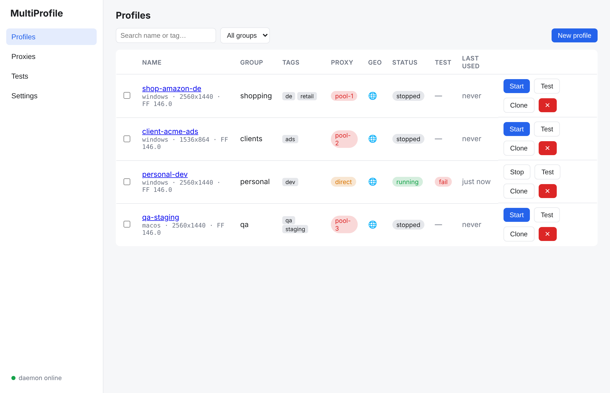
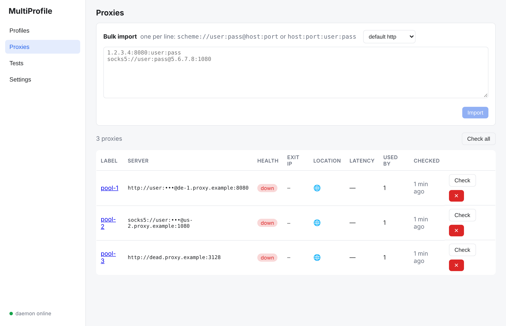
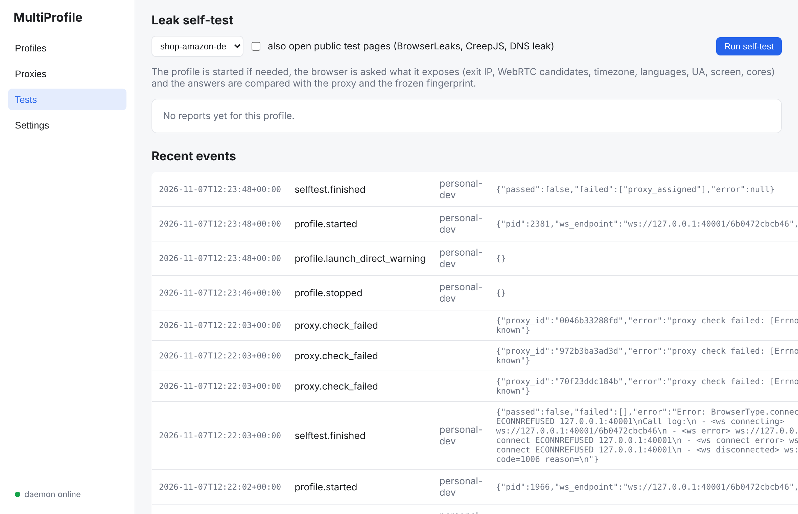

# MultiProfile

A single-user Windows desktop app for running many **fully isolated browser profiles**,
each with its own storage, proxy and a **stable, realistic fingerprint**, plus a local
REST API so your Playwright scripts can drive any profile.

Built from [PLAN.md](PLAN.md). Engine: [Camoufox](https://github.com/daijro/camoufox)
(Firefox with in-engine spoofing). Backend: Python 3.12 + FastAPI. Shell: Tauri 2 + React.

```
┌──────────────────┐  HTTP 127.0.0.1 + token   ┌───────────────────────────┐
│ Tauri window +   │ ────────────────────────▶ │ daemon (FastAPI, frozen   │
│ tray icon        │  starts/stops sidecar     │ with PyInstaller)         │
└──────────────────┘                           │  profiles · fingerprints  │
┌──────────────┐  POST /profiles/:id/start     │  proxies+geo · launcher   │
│ your scripts │ ────────────────────────────▶ │  self-test · vault        │
│ (Playwright) │ ◀── { ws_endpoint } ───────── │  backup · cookies         │
│              │ ══ connect(ws_endpoint) ════▶ │ Camoufox (one per profile)│
└──────────────┘                               └───────────────────────────┘
```

## Status

| Area | State |
|---|---|
| Daemon: profiles, frozen fingerprints, proxies + geo alignment, locks + kill switch, API, self-test, cookies, clone, encrypted backup, crash recovery | implemented, 80 unit/integration tests on a mock engine |
| Camoufox engine (persistent profile served over a Playwright websocket) | implemented against Camoufox 0.5.9 / Playwright 1.64; needs a machine that can download the browser to run end to end |
| Desktop app (Tauri 2 shell, tray, sidecar, React screens) | implemented; the Rust shell compiles on Windows with Rust + VS Build Tools installed |
| Packaging (PyInstaller sidecar, NSIS/MSI, updater) | scripts and config in place; code signing optional |

## Quick start (development)

```powershell
# Python side
uv venv -p 3.12 && .venv\Scripts\activate
uv pip install -e ".[dev]"
python -m camoufox fetch                 # one-time browser download (~150 MB)
python -m app                            # daemon on http://127.0.0.1:47821

# Desktop side (separate terminal)
cd desktop
npm install
npm run tauri dev                        # or `npm run dev` for the web UI only
```

Data lives in `%LOCALAPPDATA%\MultiProfile\` (`MULTIPROFILE_DATA_DIR` overrides it):
`multiprofile.sqlite3`, `profiles/<id>/user-data/`, `backups/`, `logs/`, `api_token`.

Without a desktop build you can use the web UI in a browser: run `npm run dev`, open
http://localhost:1420 and paste the token from `api_token` once.

## Using profiles from scripts

```python
from app.client import profile

with profile("shopping-1") as page:          # starts the profile if needed, connects Playwright
    page.goto("https://example.com")
    print(page.title())
# the browser window stays open for manual use; MultiProfile().stop("shopping-1") closes it
```

Or over raw HTTP:

```
POST /profiles/{id}/start   -> {"ws_endpoint": "ws://127.0.0.1:.../...", "pid": 1234}
```

then `playwright.firefox.connect(ws_endpoint)` and use `browser.contexts[0]`, which is the
persistent, on-disk profile (the engine serves it in Playwright's shared-browser mode).

## API

All endpoints except `/health` need `Authorization: Bearer <token>` (token in `api_token`).

```
GET/POST        /profiles                     list (?group=&tag=&status=) / create (freezes a fingerprint)
GET/PATCH/DELETE /profiles/{id}               DELETE needs ?confirm=true (removes data dir)
POST            /profiles/{id}/clone          new id + NEW fingerprint, {"copy_cookies": true} optional
POST            /profiles/{id}/regenerate-fingerprint
POST            /profiles/{id}/start|stop     start -> ws_endpoint; refuses if the proxy is down
GET             /profiles/running
POST            /profiles/groups/{g}/start|stop
GET/POST        /profiles/{id}/cookies/export|import   json or netscape
POST/GET        /profiles/{id}/selftest       run (?external=true visits public leak pages) / history
GET             /profiles/{id}/events
GET/POST/PATCH/DELETE /proxies ; POST /proxies/bulk-import ; POST /proxies/{id}/check ; POST /proxies/check-all
GET             /proxies/shared-exit-ips
POST            /backup/export {profile_ids, passphrase} ; POST /backup/import {path, passphrase}
GET             /engine/status ; POST /engine/install     (first-run browser download)
GET             /settings ; GET /events ; POST /shutdown
```

## Design rules the code enforces

1. **Consistency over randomness.** Fingerprints come whole from Camoufox's generator
   (real-world distributions), never field by field.
2. **Stability.** Generated once at create, stored as JSON, passed unchanged to every launch.
   Regeneration only through the API/UI.
3. **Match the host OS.** New profiles default to the host OS (Windows on Windows).
4. **Proxy-aligned geo.** Before every launch the proxy is checked, its exit IP is looked up in a
   *local* GeoIP DB, and timezone, locale, languages and geolocation are set from it. WebRTC is
   pinned to the proxy IP or disabled.
5. **One identity, one IP.** Proxies sharing an exit IP are flagged in the UI and the event log.
6. **No silent fallback.** A dead proxy refuses the launch; Firefox is told never to bypass the proxy.
7. **Verify.** The self-test runs after create, proxy change and regenerate, and from the UI any time.

## Security

* Master key in Windows Credential Manager (`keyring`); `MULTIPROFILE_MASTER_KEY` or a 0600
  key file are the fallbacks for headless setups.
* Proxy passwords sealed with libsodium `SecretBox`.
* Backups: tar + zstd, encrypted with a passphrase (argon2id → XChaCha20-Poly1305 secretstream),
  so they restore on another machine.
* API bound to `127.0.0.1` with a random token generated on first run.

## Packaging (Windows)

```powershell
uv run python scripts/build_daemon.py     # PyInstaller onedir -> desktop/src-tauri/binaries/
cd desktop && npm run tauri build         # NSIS .exe + .msi in src-tauri/target/release/bundle/
```

The browser itself is not in the installer; the app offers to download it on first run.
Generate app icons once with `npm run tauri icon path/to/icon.png` (1024×1024) — placeholders
are produced by `python scripts/make_icons.py`.

Updater: set `plugins.updater.pubkey` and `endpoints` in `desktop/src-tauri/tauri.conf.json`
(`npm run tauri signer generate`).

## Tests

```
uv run pytest            # unit + service tests (mock engine, no browser needed)
uv run pytest -m integration   # real Camoufox launch (needs `camoufox fetch`)
```

## Environment variables

| Variable | Meaning |
|---|---|
| `MULTIPROFILE_DATA_DIR` | data folder (default `%LOCALAPPDATA%\MultiProfile`) |
| `MULTIPROFILE_PORT` | API port (47821) |
| `MULTIPROFILE_ENGINE` | `camoufox` (default) or `mock` |
| `MULTIPROFILE_HEADLESS` | `1` to run browsers headless (not recommended) |
| `MULTIPROFILE_REQUIRE_PROXY` | `1` to refuse launching profiles without a proxy |
| `MULTIPROFILE_AUTO_SELFTEST` | `0` to disable automatic self-tests |
| `MULTIPROFILE_GEOIP_DB` | path to a MaxMind GeoLite2-City.mmdb (else Camoufox's DB) |
| `MULTIPROFILE_MASTER_KEY` | base64 32-byte key overriding the OS credential store |

## Responsible use

This is for managing your own accounts and identities privately: separating work, personal and
client logins, privacy, and QA testing. Many platforms prohibit multiple or duplicate accounts
and ban evasion in their terms; using a tool like this for fake accounts or fraud can carry
legal liability.

## Screenshots

Web UI against the daemon with the mock engine (`docs/screenshots/`):




