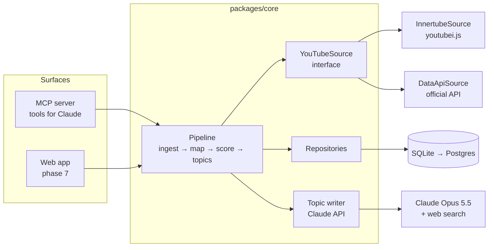

# Architecture

## Shape

One TypeScript codebase. The research engine is a library; the MCP server and the
web app are thin shells over it.



## Stack

| Concern        | Choice                                                       | Why                                                                                                                            |
| -------------- | ------------------------------------------------------------ | ------------------------------------------------------------------------------------------------------------------------------ |
| Language       | TypeScript, Node 22                                          | One language for engine, MCP server and web app                                                                                |
| YouTube access | `youtubei.js` behind an interface                            | Verified to return the needed fields; swappable                                                                                |
| Storage        | SQLite (`better-sqlite3`) in v1                              | Single user, zero setup; schema is Postgres-compatible                                                                         |
| Validation     | Zod at every boundary                                        | Tool inputs, scraped payloads and model output are all untrusted                                                               |
| Model          | `claude-opus-5-5`, structured outputs                        | Topic JSON must match a schema; forced tool choice is not available on this model                                              |
| MCP            | `@modelcontextprotocol/sdk`, stdio first, HTTP later         | stdio is enough for a personal connector                                                                                       |
| Web            | Vite + React + Tailwind, served by a small local Node server | A personal tool on one machine needs no server rendering; the API is a plain request-to-response function that is easy to test |
| Tests          | Vitest, 80% coverage floor                                   | Fixture-driven parsers and pure scoring functions                                                                              |

## Repository layout

```
packages/
  core/
    src/
      sources/        YouTubeSource interface, InnertubeSource, DataApiSource, parsers
      crawl/          BFS crawl, edge building, rate limiter
      scoring/        age ramp and outlier score
      map/            title similarity, peers ("like yours"), tiers, breakouts, stored snapshots
      db/             SQLite connection and numbered migrations
      repos/          ChannelRepo, VideoRepo, EdgeRepo, MapRepo
      ingest.ts       reads one channel into the store
      discovery/      (planned) search-based candidates
      topics/         (planned) evidence builder, prompt, schema, novelty and fact checks
    test/fixtures/    recorded InnerTube payloads
  server/             local JSON API and static file server (127.0.0.1 only)
  mcp/                the Claude connector: tools over the server's engine (stdio)
apps/
  web/                the radar screen
docs/
```

Organised by feature, files kept small, business logic depends on interfaces
(`YouTubeSource`, repositories, `TopicWriter`) so each can be faked in tests.

## Data flow for one run

1. **Resolve** the handle to a channel id.
2. **Ingest** the centre channel's long-form videos.
3. **Crawl** recommendations to depth 2 (`CRAWL.md`).
4. **Discover** extra candidates by searching YouTube for the centre's title patterns.
5. **Filter** candidates for relevance; assign closeness tiers.
6. **Score** every video with an age-adjusted outlier score.
7. **Pause for curation** (web) or proceed with the top set (MCP, with the list returned).
8. **Write topics**: build an evidence pack, call Claude, validate the JSON.
9. **Check** each topic: nearest existing video on YouTube, and fact claims with sources.
10. **Store and return** the run.

Steps 2 to 6 emit progress events (`reading 14 of 88 channels`) so both surfaces can
show live status. A run is resumable: every step reads from and writes to the store.

## Cross-cutting

- **Rate limiting.** One limiter for all YouTube requests: 2 concurrent, 300 to
  600 ms jitter, exponential backoff on 429 and 5xx, circuit breaker after
  repeated failures.
- **Caching.** Channel videos 24 h, recommendation edges 7 d, search results 24 h.
  A second run on the same channel costs almost no requests.
- **Errors.** Every tool and API response uses one envelope:
  `{ success, data, error, meta }`. Partial results are returned with
  `meta.warnings` rather than failing the run.
- **Secrets.** `ANTHROPIC_API_KEY` and optional `YOUTUBE_API_KEY` from the
  environment, validated at startup. Nothing in source.
- **Untrusted text.** Video titles and channel names are attacker-controlled
  strings. They are passed to the model inside a clearly delimited data block and
  are HTML-escaped in the UI.
- **Observability.** Structured logs per run: request counts, cache hits, model
  tokens and cost.

## Deployment

- **v1:** local process started by Claude as a stdio MCP server; SQLite file on disk.
- **Product:** web app plus a worker for runs, Postgres, a job queue, remote MCP
  over HTTP with OAuth. Not designed in detail until the PRD's first open question
  is answered.
