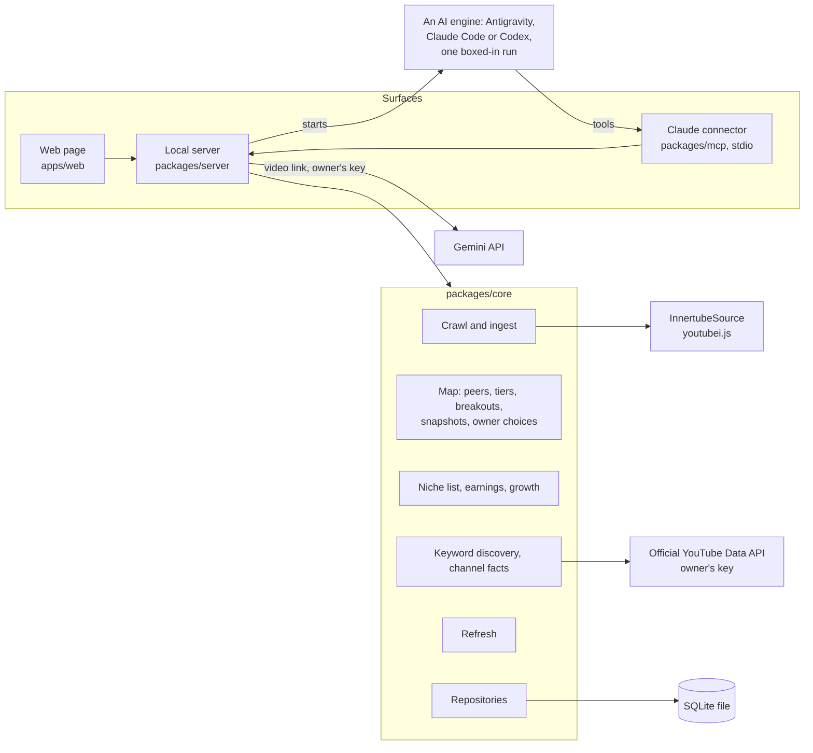

# Architecture

## Shape

One TypeScript codebase in three layers. The research engine is a library
(`packages/core`). Two thin shells sit over it: a local web server with a page
(`packages/server`, `apps/web`) and a Claude connector (`packages/mcp`). An AI
the owner already pays for does the judging: Antigravity, Claude Code or Codex,
started by the server, or Claude in a chat through the connector. The one model
API Jgtube calls itself is Gemini's, to watch a video, and only with the owner's
own key.



Known wrinkle: the connector builds its engine by importing the server's
`engine.ts`, and opens a second connection for the two reads the engine does not
expose. Moving the engine into core behind one façade is the next refactor; it is
not done.

## Stack

| Concern       | Choice                                                                                                                                  | Why                                                                                               |
| ------------- | --------------------------------------------------------------------------------------------------------------------------------------- | ------------------------------------------------------------------------------------------------- |
| Language      | TypeScript, Node 22                                                                                                                     | One language for engine, connector, server and page                                               |
| YouTube pages | `youtubei.js` behind the `YouTubeSource` interface                                                                                      | Returns the needed fields; replaceable in tests and if it breaks                                  |
| Official API  | Plain `fetch` to the YouTube Data API with the owner's key                                                                              | Only for keyword search and exact channel facts; it cannot read recommendations                   |
| Storage       | SQLite (`better-sqlite3`), numbered migrations                                                                                          | Single user, one file, no setup                                                                   |
| Validation    | Zod at every boundary                                                                                                                   | Request bodies, scraped pages, API replies, stored JSON and Claude Code's reply are all untrusted |
| Judgement     | The owner's AI plans: one-shot runs of Antigravity, Claude Code or Codex started by the server, or Claude in chat through the connector | No separate bill; each run is limited to Jgtube's read-only tools as far as that program allows   |
| Video         | Antigravity on a local file, or plain `fetch` to the Gemini API with the owner's key                                                    | The two documented or proven ways to have a model watch picture and sound                         |
| Connector     | `@modelcontextprotocol/sdk`, stdio                                                                                                      | Enough for a tool on the owner's own computer                                                     |
| Web           | Vite + React + Tailwind, served by a small local Node server                                                                            | No server rendering needed; the API is a plain request-to-response function that is easy to test  |
| Tests         | Vitest, 80% coverage floor                                                                                                              | Fixture-driven parsers, pure scoring, routes through the real engine with fake sources            |

## Repository layout

```
packages/
  core/src/
    sources/      YouTubeSource, InnertubeSource, parsers, rate limiter, official API client
    crawl/        recommendation crawl and edge building
    scoring/      outlier score with its evidence; earnings estimate
    map/          title-format matching, peers, tiers, breakouts, frozen snapshots,
                  owner choices (keep / remove), same-topic list, thumbnail board
    niches/       new-or-small channels with a video that took off; growth; facts
    discovery/    keyword search into the store
    refresh/      re-reading the stalest channels
    db/           SQLite connection and migrations
    repos/        channels, videos, edges, maps, watchlist, refresh runs
    ingest.ts     reads one channel into the store
    cli.ts        ingest, map, refresh from the command line
  server/src/
    main.ts       HTTP server on 127.0.0.1, static files, security headers, refresh timer
    app.ts        the JSON API as a function from request to response
    engine.ts     wires the API to the store, YouTube and Claude
    jobs.ts       long-running crawls and refreshes, one at a time
    analyses.ts, analysisEngine.ts, analysisRoutes.ts
                  the three "Ask AI" analyses: a fixed question, read-only tools,
                  one boxed-in run of the first engine that is ready
    engines/      the engine interface; Claude Code, Codex CLI and Antigravity CLI
                  behind it; trying them in order; watching a video (Antigravity on a
                  file, the Gemini API on a link); starting programs safely on Windows
    cli.ts        `npm run engines`: what is installed and signed in, and `--try`
  mcp/src/        the connector: ten tools and one prompt over the same store
apps/web/src/     one page: radar, breakouts, same-topic list, thumbnail board,
                  Ask AI, niches, refresh bar
docs/  design/
```

Business logic depends on interfaces (`YouTubeSource`, the repositories, the
injected search, facts, engines, program starter and video downloader) so each
can be faked in tests.

## Data flow

**Making a map.** Resolve the channel; ingest its videos; follow recommendations
one to three steps out within a channel limit (`CRAWL.md`); score every video;
decide which channels are look-alikes; freeze the result as a snapshot. Progress
is reported as the crawl runs. Everything read is kept, so a repeat costs few
requests.

**Reading a map.** The frozen snapshot is loaded and the owner's keep and remove
choices are applied on top, so choices survive new maps. The breakout feed, the
same-topic list and the thumbnail board are computed from the snapshot and the
stored videos.

**Niches.** Independent of any one map: every stored channel is checked for
"new or small, with a recent video that outperforms". Keyword discovery and
refresh add to the store; the list reflects them on the next read.

**Asking an AI.** The server builds a fixed question for a validated channel and
tries the engines in the owner's order (Claude Code, then Antigravity and Codex
as backups, by default), or asks only the one engine chosen on the page's switch. Each is started once with only the connector's read-only tools, the
owner's API keys withheld, and a private working folder of its own. An engine
that cannot answer, for whatever reason, is passed over and the next is tried. The engine reads the store through the tools
and returns plain text, which the page shows as text with the engine's name.

**Watching a video.** Antigravity watches a copy of the file placed in a fresh
folder, when it is installed and a downloader has provided the file; otherwise
the Gemini API watches the public video by its link, when the owner has set a
key. No downloader is connected yet.

## Cross-cutting

- **Rate limiting.** One limiter per process for YouTube requests: 2 concurrent,
  300 to 600 ms jitter, backoff on 429 and 5xx, and crawls and refreshes stop
  after repeated failures.
- **Caching.** Channel videos 24 h, recommendation edges 7 d.
- **Errors.** Every HTTP API response uses one envelope,
  `{ success, data, error, meta }`. Connector tools return MCP results, with a
  plain sentence on failure. File paths are stripped from messages.
- **Secrets.** The optional `YOUTUBE_API_KEY` comes from `.env`, is validated for
  shape, sent only as a request header, stripped from errors, and withheld from
  every AI engine and from the connector. The optional `GEMINI_API_KEY` is read
  from the environment by the server, checked for shape, sent only as a request
  header to Google, stripped from errors and withheld from the engines. There
  is no Anthropic or OpenAI API key anywhere.
- **Untrusted text.** Video titles and channel names are attacker-controlled.
  The page renders them, and Claude's answers, as text only; links and images are
  built from validated ids. A hostile title could at most steer an engine among
  read-only tools; what else each engine could still do is listed per engine in
  the system design.
- **Local only.** The server binds to 127.0.0.1, answers only to its own Host,
  refuses cross-site writes, and has no login. It must not be exposed to a network
  as it is.

## Deployment

- **Today:** `npm start` on the owner's computer; the connector is started by
  Claude as a stdio process; one SQLite file on disk.
- **Not built:** a hosted version (login, remote connector over HTTP, Postgres,
  a job queue). The page and connector would need a login before any of that.
