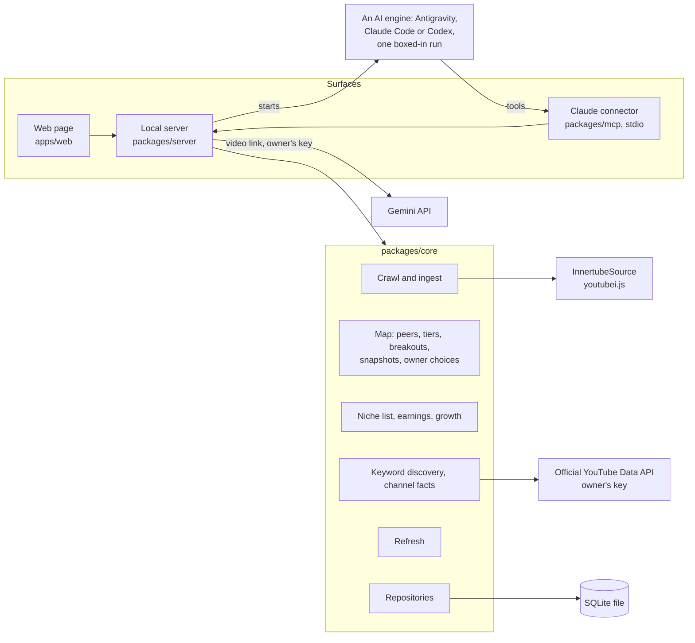

# Architecture

## Shape

One TypeScript codebase in three layers. The research engine is a library
(`packages/core`). Two thin shells sit over it: a local web server with a page
(`packages/server`, `apps/web`) and a Claude connector (`packages/mcp`). An AI
the owner already pays for does the judging: Antigravity, Claude Code or Codex,
started by the server, or Claude in a chat through the connector. The one model
API Jgtube calls itself is Gemini's, to watch a video, and only with the owner's
own key.



Known wrinkle: the connector builds its engine by importing the server's
`engine.ts`, and opens a second connection for the two reads the engine does not
expose. Moving the engine into core behind one façade is the next refactor; it is
not done.

## Stack

| Concern       | Choice                                                                                                                                  | Why                                                                                               |
| ------------- | --------------------------------------------------------------------------------------------------------------------------------------- | ------------------------------------------------------------------------------------------------- |
| Language      | TypeScript, Node 22                                                                                                                     | One language for engine, connector, server and page                                               |
| YouTube pages | `youtubei.js` behind the `YouTubeSource` interface                                                                                      | Returns the needed fields; replaceable in tests and if it breaks                                  |
| Official API  | Plain `fetch` to the YouTube Data API with the owner's key                                                                              | Only for keyword search and exact channel facts; it cannot read recommendations                   |
| Storage       | SQLite (`better-sqlite3`), numbered migrations                                                                                          | Single user, one file, no setup                                                                   |
| Validation    | Zod at every boundary                                                                                                                   | Request bodies, scraped pages, API replies, stored JSON and Claude Code's reply are all untrusted |
| Judgement     | The owner's AI plans: one-shot runs of Antigravity, Claude Code or Codex started by the server, or Claude in chat through the connector | No separate bill; each run is limited to Jgtube's read-only tools as far as that program allows   |
| Video         | Antigravity on a local file, or plain `fetch` to the Gemini API with the owner's key                                                    | The two documented or proven ways to have a model watch picture and sound                         |
| Video files   | yt-dlp when installed, else the YouTube library; ffmpeg when installed, to cut frames and shrink a large file                           | Optional programs the owner installs; without them a breakdown runs on YouTube's preview frames   |
| Connector     | `@modelcontextprotocol/sdk`, stdio                                                                                                      | Enough for a tool on the owner's own computer                                                     |
| Web           | Vite + React + Tailwind, served by a small local Node server                                                                            | No server rendering needed; the API is a plain request-to-response function that is easy to test  |
| Tests         | Vitest, 80% coverage floor                                                                                                              | Fixture-driven parsers, pure scoring, routes through the real engine with fake sources            |

## Repository layout

```
packages/
  core/src/
    sources/      YouTubeSource, InnertubeSource, parsers, rate limiter, official API client
    crawl/        recommendation crawl and edge building
    scoring/      outlier score with its evidence; earnings estimate
    map/          title-format matching, peers, tiers, breakouts, frozen snapshots,
                  owner choices (keep / remove), same-topic list, thumbnail board
    niches/       new-or-small channels with a video that took off; growth; facts
    video/        one video's own page: transcript, description and tags, storyboard frames
    channel/      a channel's branding: logo, cover, bio, keywords, links
    downloads/    files saved to disk: thumbnails and transcripts with an index, a temporary
                  video copy, frames cut from one with ffmpeg, the owner's own video files
    breakdown/    which of a channel's videos a breakdown studies
    concepts/     packaging concepts: their shapes and the strict reader of an engine's answer
    formulas/     title formulas: reading an engine's proposals and deciding what is shown
    hooks/        the first minute of a transcript, the hook library, reading style labels
    lab/          the videos of one channel's own map, which all of the above rest on
    script/       a script's measures (words, time, reading grade, check markers), picture
                  cues and the CSV shot list, a channel's voice, reading the stages' answers
                  video copy, frames cut from one with ffmpeg, the owner's own video files,
                  a breakdown's four text files
    breakdown/    which of a channel's videos and titles a breakdown studies; its parts
                  and the marker lines a ready prompt is lifted out by
    discovery/    keyword search into the store
    refresh/      re-reading the stalest channels
    changes/      what changed among a map's look-alikes since an earlier moment, from
                  stored readings (the store as it was then, judged by today's rules)
    alerts/       alert rules and the alerts they find after a refresh, from stored readings
    plan/         the owner's published videos against the concepts they came from: links,
                  views at the same age, the table of formats, hook styles and lengths
    pacing/       a channel's lengths and words a minute beside its map's breakouts
    calendar/     the upload calendar: kept concepts by week, their status and planned date,
                  and the look-alike winners' uploads a week
    extras.ts     the later features' exports, named once by index.ts
    db/           SQLite connection and migrations
    repos/        channels, videos, edges, maps, watchlist, refresh runs
    ingest.ts     reads one channel into the store
    cli.ts        ingest, map, refresh, transcript(s), thumbnails, brand, video from the command line
  server/src/
    main.ts       HTTP server on 127.0.0.1, static files, security headers, refresh timer
    app.ts        the JSON API as a function from request to response
    engine.ts     wires the API to the store, YouTube and Claude
    jobs.ts       long-running crawls and refreshes, one at a time
    analyses.ts, analysisEngine.ts, analysisRoutes.ts
                  the "Ask AI" analyses: a fixed question, read-only tools,
                  one boxed-in run of the first engine that is ready
    breakdownEngine.ts, breakdownStudies.ts, breakdownQuestions.ts,
    breakdownFiles.ts, breakdownSetup.ts, videoCopies.ts
                  the channel breakdown: a job that reads a channel's top videos,
                  finds a file of the best three, has them watched and their frames
                  studied, keeps what was written and has an engine write it up;
                  and the route that takes the owner's own video file
    labAnalyses.ts, ideaQuestions.ts, formulaQuestions.ts, hookQuestions.ts,
    ideaEngine.ts, formulaEngine.ts, hookEngine.ts, labSetup.ts, labRoutes.ts
                  the idea lab: concepts from picked videos, where else a format
                  could work, title formulas and the hook library, each a fixed
                  question run as a job, for one centre channel only
    scriptQuestions.ts, scriptEngine.ts, scriptRoutes.ts, labHttp.ts
                  the script writer: a script per concept, a voice measured from a
                  channel's own captions, three stages each read through get_script
                  studied, and keeps what was written
    breakdownParts.ts, breakdownPartQuestions.ts, breakdownBasis.ts,
    breakdownWriting.ts, breakdownStore.ts, breakdownRoutes.ts
                  its seven written parts: each a fixed question with its own
                  read-only tools and its own engine run, stored and saved as text;
                  what the breakdown rests on, worked out in code; the stored
                  breakdown read back; and the routes that start one, read one,
                  download its texts and take the owner's own video file
    logoRoutes.ts, logoEngine.ts
                  logos for a map made before logos were stored: a small job that
                  reads each channel page once, one at a time, never beside a crawl
    settingsRoutes.ts, settingsStore.ts, settingsCatalog.ts, settingsEngine.ts,
    liveSettings.ts
                  the settings screen: the `.env` file read and written with the
                  configuration's own rules, keys never sent back, and the few
                  settings that change without a restart
    extrasSetup.ts, extrasTypes.ts, extrasRoutes.ts
                  the later features, registered in one line each in engine.ts
                  (`extras`) and app.ts (`extraRoutes`); each has its own
                  `<feature>Engine.ts` and `<feature>Routes.ts`:
                  changes (what changed since the last look), alerts (plus
                  `alertsTypes.ts`), plan (your videos against the plan, plus
                  `planTypes.ts`), calendar (the upload calendar, plus `calendarTypes.ts`), pacing
                  (length and pacing, plus `pacingTypes.ts`)
    engines/      the engine interface; Claude Code, Codex CLI and Antigravity CLI
                  behind it; trying them in order; watching a video (Antigravity on a
                  file, the Gemini API on a link); starting programs safely on Windows
    cli.ts        `npm run engines`: what is installed and signed in, and `--try`
  mcp/src/        the connector: twenty tools and one prompt over the same store
  mcp/src/        the connector: eighteen tools and one prompt over the same store
apps/web/src/     one page: radar, breakouts, same-topic list, thumbnail board,
                  Ask AI, trending formats, hook library, idea lab, script writer, transfers,
                  niches, refresh bar
docs/  design/
```

Business logic depends on interfaces (`YouTubeSource`, the repositories, the
injected search, facts, engines, program starter and video downloader) so each
can be faked in tests.

## Data flow

**Making a map.** Resolve the channel; ingest its videos; follow recommendations
one to three steps out within a channel limit (`CRAWL.md`); score every video;
decide which channels are look-alikes; freeze the result as a snapshot. Progress
is reported as the crawl runs. Everything read is kept, so a repeat costs few
requests.

**Reading a map.** The frozen snapshot is loaded and the owner's keep and remove
choices are applied on top, so choices survive new maps. The breakout feed, the
same-topic list and the thumbnail board are computed from the snapshot and the
stored videos.

**Niches.** Independent of any one map: every stored channel is checked for
"new or small, with a recent video that outperforms". Keyword discovery and
refresh add to the store; the list reflects them on the next read.

**Asking an AI.** The server builds a fixed question for a validated channel and
tries the engines in the owner's order (Claude Code, then Antigravity and Codex
as backups, by default), or asks only the one engine chosen on the page's switch. Each is started once with only the connector's read-only tools, the
owner's API keys withheld, and a private working folder of its own. An engine
that cannot answer, for whatever reason, is passed over and the next is tried. The engine reads the store through the tools
and returns plain text, which the page shows as text with the engine's name.

**Watching a video.** Antigravity watches a copy of the file placed in a fresh
folder, when it is installed and the downloader has provided the file (yt-dlp
when installed, else the built-in route); otherwise the Gemini API watches the
public video by its link, when the owner has set a key. The downloaded copy is
removed when the watch is over, however it ended.

**Breaking a channel down.** A job with progress. In code: the channel's five
videos furthest above its usual views are chosen and their captions read; for
the best three a file is looked for (the owner's own, then a download, used
once for everything), an engine watches it for sound and editing, and an engine
that sees pictures goes through its frames in a run of its own (cut from the
file by ffmpeg, one a second, or YouTube's preview frames when there is no
file). What each engine wrote is stored per video and reused. Then the
breakdown is written in seven parts (titles, thumbnails, scripts, picture and
sound, strengths weaknesses and strategy, production plan, master prompt),
each its own engine run with only its own read-only tools, each stored as it
is written and kept for the next time the channel is picked. What an engine
wrote, about a video or as a part, travels only as a tool result, never inside
a question: a later part reads an earlier one through `get_breakdown_part`.
When it is done, the whole breakdown, the production plan and the two ready
prompts are saved as four text files in a folder named after the channel.

**The idea lab.** Three sections for the channel on screen, each reading only
that channel's own map. Title formulas: an engine groups the breakout titles
into wordings with named slots; code keeps a formula only when at least two
stored videos of the map inside the window stand behind it and computes every
number shown. Hook library: the first minute of what the map's top breakouts
say, cut in code from stored captions; an engine only names the way each opens.
Concepts: the owner picks up to five videos, optionally a format (by key or
id) and an angle of one line; the batch is stored, an engine reads it through
tools and answers in a fixed labelled form that a strict reader takes apart;
concepts not kept are replaced by the next batch. The owner's angle is the one
free text in any question; a format, a stored concept and the hooks reach an
engine as tool results only.

**Writing a script.** One script per kept concept. Its voice is a channel of the
same map, measured in code from the captions of that channel's best videos; its
length is chosen within the range this map's winners run. Three AI stages (hooks
and beats, draft, tighten) each read the concept and the earlier stages through
`get_script`. The engines cannot look anything up, so every stage must mark a
fact it cannot vouch for with `[CHECK: ...]`; the page counts and lists the
markers, counts words, spoken time and reading grade in code, times the picture
cues from the words, and exports text, Markdown, a CSV shot list and the clean
voiceover.

## Cross-cutting

- **Rate limiting.** One limiter per process for YouTube requests: 2 concurrent,
  300 to 600 ms jitter, backoff on 429 and 5xx, and crawls and refreshes stop
  after repeated failures.
- **Caching.** Channel videos 24 h, recommendation edges 7 d.
- **Errors.** Every HTTP API response uses one envelope,
  `{ success, data, error, meta }`. Connector tools return MCP results, with a
  plain sentence on failure. File paths are stripped from messages.
- **Settings.** The owner changes settings on the page's settings screen,
  which writes `.env` for them. A key goes in and never comes back out: the
  page is told only whether one is set.
- **Secrets.** The optional `YOUTUBE_API_KEY` comes from `.env`, is validated for
  shape, sent only as a request header, stripped from errors, and withheld from
  every AI engine. The connector's engine keeps it for one purpose, reading video
  descriptions through the official API; it is taken out of the connector's
  process environment, with every other key, and never appears in a tool's
  answer. The optional `GEMINI_API_KEY` is read from the environment by the
  server, checked for shape, sent only as a request header to Google, stripped
  from errors and withheld from the engines. There is no Anthropic or OpenAI
  API key anywhere.
- **Files on disk.** Besides the store, Jgtube writes only under one downloads
  folder (beside the store, or `JGTUBE_DOWNLOADS_PATH`): thumbnails and
  transcripts the owner asks for, a breakdown's four text files
  (`breakdowns/<channel name>/`), video files the owner sends (`my-videos`,
  never deleted by Jgtube), and what is temporary (`video-temp`: a copy of a
  video, the frames cut from it, a smaller copy for watching), removed after
  use. Paths are built with `node:path` from validated ids and checked to stay
  inside that folder.
- **Helper programs.** yt-dlp and ffmpeg are optional. Each is found by looking
  in the PATH's absolute folders, started without a shell with its arguments as
  a list, given only validated ids and absolute paths, and stopped when it runs
  too long or Jgtube closes.
- **Pictures.** Every picture is fetched from a pinned host with redirects
  refused, a time limit and a size cap: `i.ytimg.com` for thumbnails and
  storyboard sheets, `yt3.googleusercontent.com` for channel logos and covers.
- **Untrusted text.** Video titles and channel names are attacker-controlled.
  The page renders them, and Claude's answers, as text only; links and images are
  built from validated ids. A hostile title could at most steer an engine among
  read-only tools; what else each engine could still do is listed per engine in
  the system design.
- **Local only.** The server binds to 127.0.0.1, answers only to its own Host,
  refuses cross-site writes, and has no login. It must not be exposed to a network
  as it is.

## Deployment

- **Today:** `npm start` on the owner's computer; the connector is started by
  Claude as a stdio process; one SQLite file on disk.
- **Not built:** a hosted version (login, remote connector over HTTP, Postgres,
  a job queue). The page and connector would need a login before any of that.
